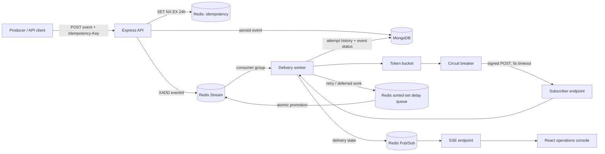

# EventStream / HookRelay — Distributed Webhook & Asynchronous Task Orchestrator

EventStream / HookRelay is a fault-tolerant distributed webhook and asynchronous task orchestrator with a real-time operations console. It accepts events quickly, delivers them asynchronously, retries transient failures, quarantines exhausted work, and exposes delivery state to operators over Server-Sent Events (SSE).

## System architecture



## Delivery lifecycle

1. A producer submits an event to the API with an optional `Idempotency-Key`.
2. Redis atomically reserves that key for 24 hours; duplicate requests return the original event ID without adding more work.
3. MongoDB stores the event as the durable audit record, then Redis Streams receives a lightweight job containing the event ID.
4. A worker claims the job, applies the per-endpoint token bucket, then checks the endpoint circuit breaker.
5. If allowed, the worker sends a signed JSON `POST` with a five-second deadline and persists a `DeliveryAttempt` record.
6. Success marks the event `delivered`. Transient failures are scheduled back to the delayed queue with exponential backoff and jitter. Permanent or exhausted failures become `failed_dlq`.
7. Each transition is published through Redis Pub/Sub to the SSE endpoint and displayed in the console.

## Resilience model

| Concern | Implementation | Behavior |
| --- | --- | --- |
| Duplicate intake | Redis `SET NX EX` | Same idempotency key returns original status for 24 hours. |
| Worker crashes | Redis Stream consumer groups + `XAUTOCLAIM` | Unacknowledged jobs are reclaimed by another worker. |
| Retry delays | Redis sorted set + atomic Lua promotion | Delayed jobs survive API and worker restarts. |
| Receiver overload | Per-endpoint Lua token bucket | Work is deferred with an exact token-replenishment delay. |
| Receiver outage | Redis shared circuit breaker | Five qualifying failures open the circuit; one HALF_OPEN probe tests recovery. |
| Auditability | MongoDB Event + DeliveryAttempt | Every actual outbound request has status, latency, body/error, and signed headers. |

## Repository layout

```text
HookRelay/
├── backend/
│   ├── src/
│   │   ├── config/       # environment, database, Redis, logger
│   │   ├── models/       # Endpoint, Event, DeliveryAttempt schemas
│   │   ├── routes/       # REST and SSE routes
│   │   ├── services/     # ingestion, stream, delivery, circuit, rate limiting
│   │   ├── lua/          # atomic Redis scripts
│   │   └── workers/      # Redis Stream consumer process
│   └── README.md         # backend API and delivery details
└── frontend/
    ├── src/
    │   ├── api/          # REST/SSE client
    │   ├── components/   # reusable console components
    │   ├── pages/        # route-level views
    │   ├── auth/         # development session flow
    │   └── theme/        # persisted light/dark theme
    └── README.md         # dashboard setup
```

## Quick start

Prerequisites: Node.js 20+, Redis, and MongoDB.

```bash
# Terminal 1 — API
cd backend
cp .env.example .env
npm install
npm run dev
```

```bash
# Terminal 2 — worker
cd backend
npm run worker
```

```bash
# Terminal 3 — operations console
cd frontend
cp .env.example .env
npm install
npm run dev
```

The API listens on `http://localhost:3000`; Vite normally serves the console at `http://localhost:5173`.

## Core API surface

| Method | Route | Description |
| --- | --- | --- |
| `POST` | `/api/v1/endpoints` | Register a signed subscriber endpoint. |
| `POST` | `/api/v1/events` | Persist and enqueue a delivery event. |
| `GET` | `/api/v1/events/stream` | Subscribe to live delivery transitions via SSE. |
| `GET` | `/api/v1/events/:id` | Read an event and chronological attempt history. |
| `GET` | `/api/v1/events/dlq` | List quarantined events. |
| `POST` | `/api/v1/events/:id/replay` | Reset and re-enqueue a DLQ event. |
| `GET` | `/api/v1/endpoints/:id/circuit` | Read distributed circuit state for a dashboard badge. |

For the complete API contract, signing headers, configuration, and production hardening guidance, see [backend/README.md](./backend/README.md). For console configuration and routes, see [frontend/README.md](./frontend/README.md).
